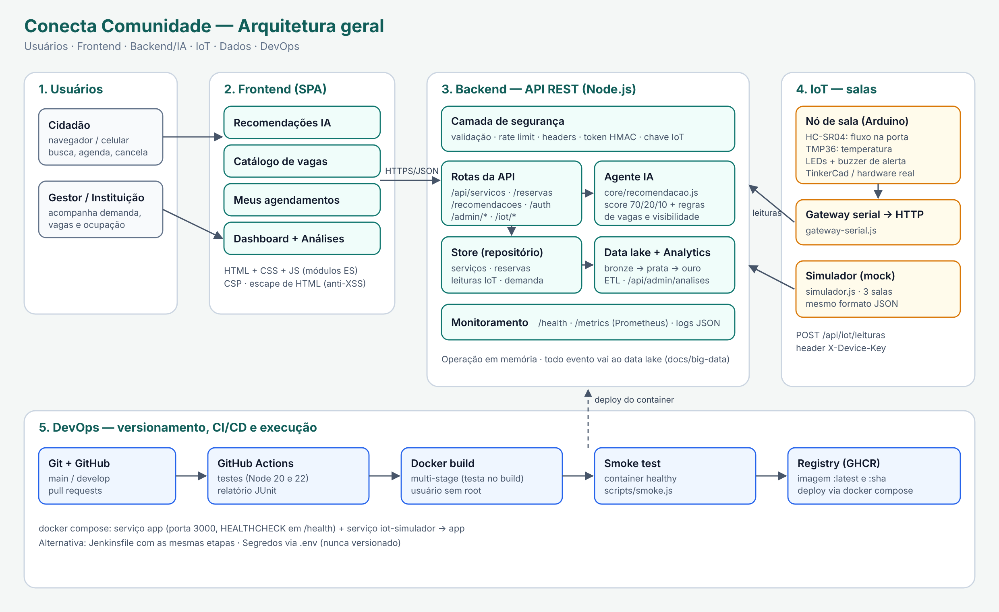

# Conecta Comunidade · CitizenTech

> Tecnologia aproximando pessoas de oportunidades — ODS 10 (Redução das desigualdades) e ODS 11 (Cidades e comunidades sustentáveis).

Plataforma que conecta cidadãos a vagas em **cursos gratuitos, capacitações, atendimentos sociais e serviços comunitários**. Um agente de IA recomenda as vagas mais compatíveis com o perfil da pessoa e sensores IoT medem a ocupação das salas. Todo evento alimenta um **data lake** (bronze → prata → ouro), e um dashboard analítico transforma esses dados em decisões: onde abrir turmas, o que divulgar e qual sala climatizar.

> **Vídeo pitch:** [LINK PÚBLICO DO VÍDEO](https://docs.google.com/videos/d/1YX4MJg2Ghfv9gKMvCdrSGGlR2cmxQNQSLAxfmKya3QI/play?usp=sharing)]
> **Entregáveis (arquitetura, prints e evidências de cada área):** [`Conecta-Comunidade-Entregaveis.pdf`](Conecta-Comunidade-Entregaveis.pdf)
> **Grupo Vaga Certa:** Samuel Giron Marciliano (RM98693), Lucas Santana de Oliveira (RM550851), Allan Silva Marcelino (RM99860) e Yohana Bispo Menezes (RM551430). Dados da entrega em [`ENTREGA.txt`](ENTREGA.txt) · **Roteiro do pitch:** [`docs/roteiro-pitch.md`](docs/roteiro-pitch.md)



## Como rodar

Requisito: **Node.js 22 ou mais novo** (não há dependências para instalar). Os comandos funcionam de qualquer pasta, em Windows, Linux ou macOS.

```bash
npm start          # http://localhost:3000
npm run iot        # em outro terminal: simulador dos sensores IoT
npm run dados      # (re)gera o histórico de 90 dias e roda o ETL do data lake
npm test           # 33 testes automatizados
npm run ia:avaliar # avaliação antes × depois do agente IA
npm run smoke      # smoke test contra a aplicação no ar
```

Com Docker:

```bash
cp .env.example .env
node scripts/gerar-hash.js "sua-senha-forte"   # cole em ADMIN_PASSWORD_HASH
# preencha TOKEN_SECRET, IOT_DEVICE_KEY e PSEUDONIMO_SECRET
docker compose up --build                      # app + simulador IoT
docker compose run --rm etl                    # reprocessa o data lake no container
```

Login do dashboard em modo de desenvolvimento: `admin` / `conecta2026`.

## Mapa de entregas da Global Solution

### Área 1 — IA e automação

Documentação completa em [`docs/ia/`](docs/ia/README.md), com versão em PDF pronta para o relatório: [`docs/ia/area1-ia-e-automacao.pdf`](docs/ia/area1-ia-e-automacao.pdf).

O agente **Conecta-IA** resolve uma parte real do problema: entende o pedido escrito do jeito do cidadão ("to sem trampo", "vendo artesanato") e indica, entre as vagas da comunidade, as que ele consegue usar de fato (necessidade, horário e vagas restantes), com justificativa e próximo passo.

| Item | Entrega | Onde |
|------|---------|------|
| **01 · IA aplicada** | Agente de recomendação implementado e integrado à plataforma: interpreta texto livre, pontua o catálogo com o saldo de vagas em tempo real, ranqueia, explica o cálculo e decide o próximo passo (reservar, confirmar outro turno ou encaminhar ao acolhimento) | `src/core/recomendacao.js`, `POST /api/recomendacoes`, tela **Recomendações IA** |
| **02 · Prompts, agentes ou automação** | System prompt completo do agente (papel, entrada, 6 regras, vocabulário, privacidade, formato JSON de saída e exemplo), tabela regra → código → teste, e 9 regras de automação da plataforma (baixa de vaga, devolução, alertas IoT, ingestão no data lake, insights do gestor, CI) | [`docs/ia/prompt-do-agente.md`](docs/ia/prompt-do-agente.md) e PDF |
| **03 · Demonstração** | 3 cenários na tela, cálculo visível em cada card ("objetivo 70/70 · turno 20/20 · impacto 7/10") e JSON de entrada e saída de 5 cenários (incluindo v1 × v2) | prints `01`–`04` e `11`, [`docs/ia/evidencias/exemplos-entrada-saida.json`](docs/ia/evidencias/exemplos-entrada-saida.json) |
| **04 · Lógica e ganho** | Avaliação **antes × depois** com gabarito de 54 perfis (38 de ajuste + 16 de validação nunca usados no ajuste): mural de vagas sem IA × agente v1 × agente v2 | [`docs/ia/evidencias/avaliacao-antes-depois.md`](docs/ia/evidencias/avaliacao-antes-depois.md), `npm run ia:avaliar` |

**Ganho medido** (conjunto de validação):

| Métrica | Antes: mural sem IA | Agente v1 | **Agente v2** |
|---|---:|---:|---:|
| 1ª sugestão é adequada | 64,3% | 85,7% | **92,9%** |
| Sugestões que são adequadas (precisão) | 53,6% | 81,3% | **82,4%** |
| Tinha opção certa e ficou sem resposta | 0% | 14,3% | **0%** |
| Viu serviço esgotado | 37,5% | 0% | **0%** |
| Pedido fora do catálogo → encaminhou ao acolhimento | 0% | 100% | **100%** |

A v2 nasceu do dashboard de Big Data, que mostrou buscas de "geração de renda" sem resultado mesmo com vagas sobrando. Ela acrescenta três coisas:
- **Vocabulário do dia a dia:** 47 equivalências entre palavras comuns e as palavras-chave dos serviços.
- **Regra 5:** sem opção no turno pedido, sugere a mais próxima em outro turno, avisando.
- **Regra 6:** descarta opções mais de 20 pontos abaixo da melhor.

**Exemplo de entrada e saída** (o mesmo pedido nas duas versões):

```json
// Entrada
{ "cidadao": "Joana Souza", "situacao_atual": "Buscando renda extra / empreender",
  "interesse_principal": "Geração de renda", "turno_disponivel": "noite",
  "descricao_livre": "vendo artesanato e quero ganhar mais dinheiro" }

// Saída — agente v1: nenhuma recomendação ("vendo", "artesanato" e "dinheiro" não eram reconhecidos)
// Saída — agente v2 (atual), resumida:
{ "agente": "Conecta-IA-v2",
  "recomendacoes": [ { "id_servico": "SRV-04", "titulo": "Oficina de Empreendedorismo e Microcrédito Comunitário",
                       "score_compatibilidade": 97, "prioridade": "Alta aderência", "vagas_disponiveis": 12 } ],
  "proximo_passo_sugerido": "Reservar \"Oficina de Empreendedorismo e Microcrédito Comunitário\", a opção de maior compatibilidade.",
  "_detalhe_regras": [ { "id_servico": "SRV-04", "palavras_chave_acertadas": 5, "pontos_objetivo_70": 70,
                         "pontos_turno_20": 20, "pontos_impacto_social_10": 7, "score_ranking": 97 } ] }
```

### Área 2 — Big Data e visualização

Documentação completa em [`docs/big-data/`](docs/big-data/README.md).

| Item | Entrega | Onde |
|------|---------|------|
| **Estrutura dos dados** | Data lake em 3 camadas (bronze particionado por tipo/data, prata limpa, ouro em **modelo estrela** com 4 dimensões e 4 fatos) + quarentena, catálogo e dicionário de dados | `datalake/`, `docs/big-data/README.md` §1–2 |
| **Ingestão e processamento** | Eventos reais do app e dos sensores → bronze (com pseudonimização LGPD); gerador de 90 dias de histórico com dados sujos; ETL que valida, deduplica, normaliza, reconstrói a ocupação e modela o ouro (43.635 → 43.086 registros, 98,7%) | `src/dados/ingestao.js`, `etl.js`, `docs/big-data/pipeline.png`, `docs/big-data/evidencias/` |
| **Dashboard** | Tela **Análises (Big Data)**: 6 indicadores com variação vs período anterior, 5 filtros (período, datas, eixo, turno, sala), 4 gráficos e o painel "O que decidir agora" | `public/js/telas/analises.js`, prints `09` e `10` |
| **Funções analíticas** | Medidas equivalentes a DIVIDE, PERCENTILE.INC, DATEADD, média móvel (DATESINPERIOD), RANKX e ALL, com o código DAX pronto para Power BI | `src/dados/medidas.js`, `docs/big-data/medidas-dax.md` |

### Área 3 — MVP, IoT e experiência digital

| Item | Entrega | Onde |
|------|---------|------|
| **Protótipo** (4+ telas) | 6 telas web funcionais: Recomendações IA, Catálogo de vagas, Meus agendamentos, Login do gestor, Dashboard operacional e Análises (Big Data) | `public/`, screenshots em `docs/evidencias/01`–`08` |
| **IoT** (2+ sensores) | Nó de sala com **HC-SR04** (fluxo de pessoas na porta) e **TMP36** (temperatura), LEDs e buzzer de alerta. Sketch para TinkerCad + simulador mock com o mesmo formato JSON + gateway serial→HTTP | `iot/arduino/no_sala.ino`, `src/iot/simulador.js`, `src/iot/gateway-serial.js` |
| **Fluxo funcional** | Perfil → recomendação → agendamento → protocolo → check-in pelo sensor → dashboard do gestor | `docs/fluxo-funcional.md` |
| **Arquitetura** | Diagrama geral com as 5 áreas e suas conexões | `docs/arquitetura.svg` / `.png` |

### Área 4 — DevOps, segurança e qualidade

| Item | Entrega | Onde |
|------|---------|------|
| **Organização** | Módulos separados (núcleo IA, servidor, IoT, frontend, testes, docs) e histórico Git com commits por etapa | estrutura abaixo, `git log` |
| **DevOps** | Dockerfile multi-stage (testa no build, roda sem root, HEALTHCHECK), docker compose (app + IoT + ETL, volume do data lake), pipeline **GitHub Actions** (testes Node 22/24 → pipeline de dados com checagem de qualidade → build → container healthy → smoke test → publica no GHCR), Jenkinsfile alternativo, monitoramento `/health` e `/metrics` (Prometheus) e logs JSON | `Dockerfile`, `docker-compose.yml`, `.github/workflows/ci.yml`, `Jenkinsfile` |
| **Segurança** | 11 práticas: uma vaga por pessoa em cada serviço (CPF validado, guardado só como chave HMAC), pseudonimização LGPD no data lake, validação de entrada, anti-XSS + CSP, senha scrypt + token HMAC, chave de dispositivo IoT, rate limit, cabeçalhos, LGPD (minimização e máscara), segredos obrigatórios em produção, container sem root | `docs/seguranca.md` |
| **Testes** | Plano com 33 casos automatizados + 11 E2E, todos aprovados, com evidências | `docs/plano-de-testes.md`, `docs/evidencias/` |

## Código por área

As 4 áreas resolvem o mesmo problema e estão integradas: a IA usa o saldo de vagas da operação, os sensores alimentam o dashboard e todo evento vai para o data lake.

| Área | Código | Como rodar e ver funcionando |
|------|--------|------------------------------|
| **1 · IA e automação** | `src/core/recomendacao.js` (agente), `src/core/avaliacao.js` (gabarito e métricas), `scripts/avaliar-ia.js` | `npm start` → aba **Recomendações IA**; `npm run ia:avaliar` (antes × depois) |
| **2 · Big Data e visualização** | `src/dados/` (ingestão, gerador, ETL, medidas, análises), `datalake/`, `public/js/telas/analises.js` | `npm run dados` → `npm start` → aba **Análises (Big Data)** (`admin` / `conecta2026`) |
| **3 · MVP, IoT e experiência digital** | `public/` (6 telas), `src/server/` (API), `src/iot/` (simulador e gateway), `iot/arduino/no_sala.ino` (TinkerCad) | `npm start` + `npm run iot` → abas Catálogo e Dashboard |
| **4 · DevOps, segurança e qualidade** | `Dockerfile`, `docker-compose.yml`, `.github/workflows/ci.yml`, `Jenkinsfile`, `src/server/seguranca.js`, `tests/` | `npm test`; `docker compose up --build`; aba Actions do GitHub |

## Estrutura

```
conecta-comunidade/
├── src/
│   ├── core/            # Agente IA (regras puras, sem I/O), catálogo e avaliação antes × depois
│   ├── server/          # API REST, segurança, store em memória
│   ├── dados/           # Data lake: ingestão, gerador, ETL, medidas e análises
│   └── iot/             # Simulador de sensores e gateway serial
├── datalake/ouro/       # Camada ouro versionada (bronze/prata: npm run dados)
├── public/              # Frontend SPA (HTML, CSS, JS em módulos)
│   └── js/telas/        # Uma tela por arquivo
├── iot/arduino/         # Sketch do nó de sala (TinkerCad)
├── tests/               # Testes unitários e de integração (node:test)
├── scripts/             # smoke test, avaliação da IA, PDF da Área 1, gerar hash, captura de telas
├── docs/                # Arquitetura, IA, Big Data, fluxo, testes, segurança, evidências
├── .github/workflows/   # CI/CD
├── Dockerfile · docker-compose.yml · Jenkinsfile
```

## API

| Método | Rota | Acesso | Descrição |
|--------|------|--------|-----------|
| GET | `/api/servicos` | público | Catálogo com saldo de vagas e ocupação da sala |
| POST | `/api/recomendacoes` | público | Executa o agente IA para um perfil |
| POST | `/api/reservas` | público | Reserva uma vaga com nome e CPF (baixa imediata no saldo; uma reserva ativa por CPF em cada serviço) |
| GET | `/api/reservas/:protocolo` | público | Consulta uma reserva |
| POST | `/api/reservas/:protocolo/cancelar` | público | Cancela e devolve a vaga |
| POST | `/api/auth/login` | público | Login do gestor → token |
| GET | `/api/admin/dashboard` | gestor | Indicadores de demanda, vagas e ocupação |
| GET | `/api/admin/reservas` | gestor | Reservas (nomes mascarados) |
| GET | `/api/admin/analises` | gestor | Indicadores de Big Data (`?inicio&fim&eixo&turno&sala`) |
| POST | `/api/iot/leituras` | dispositivo | Leitura de sensor (`X-Device-Key`) |
| GET | `/api/iot/salas` | público | Ocupação atual das salas |
| GET | `/health`, `/metrics` | público | Monitoramento |

## IoT no TinkerCad

1. Crie um circuito com Arduino Uno, HC-SR04, TMP36, um botão, 2 LEDs (verde/vermelho) e um buzzer conforme o cabeçalho de `iot/arduino/no_sala.ino`.
2. Cole o código e inicie a simulação; mova o "objeto" do sensor ultrassônico para menos de 60 cm para simular uma passagem (segure o botão para "saída").
3. O Monitor Serial mostra linhas JSON. Salve-as em `leituras.txt` e envie para a API com `node src/iot/gateway-serial.js < leituras.txt`.

## Evolução prevista

Banco de dados (PostgreSQL) no lugar do store em memória, data lake em armazenamento de objetos (S3/Azure Blob) com Parquet, cadastro das instituições e notificações por WhatsApp/SMS.


A equipe revisou o código e a documentação, executou os testes e o roteiro de demonstração e é responsável pelo conteúdo entregue. As decisões de produto (problema, público, regras do agente, uma vaga por pessoa) foram da equipe.

