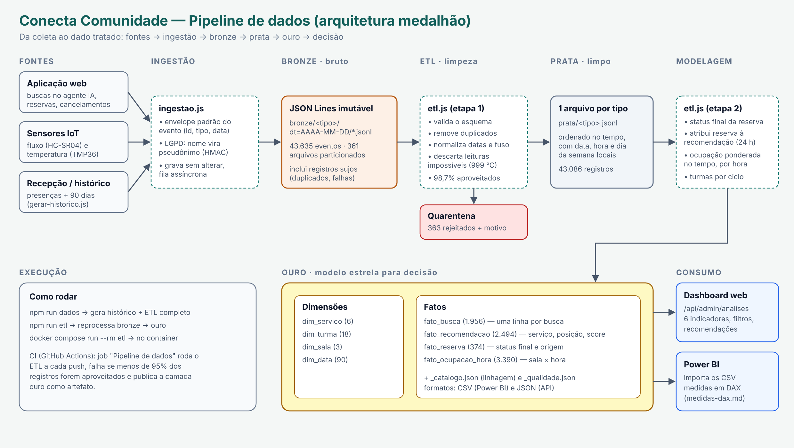
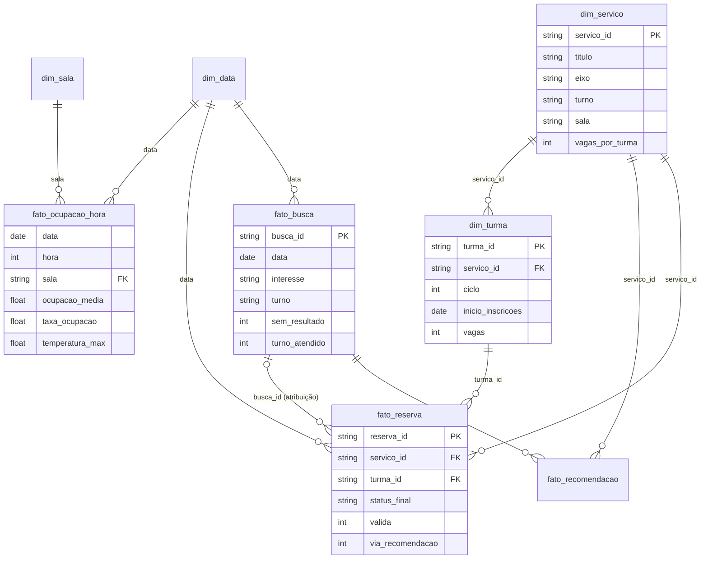

# Big Data e visualização — Conecta Comunidade

Como os dados da plataforma são **organizados, processados e transformados em informação para decidir melhor**.



| Item da Área 2 | Onde está |
|---|---|
| **01 · Estrutura dos dados** | Data lake em 3 camadas (bronze, prata, ouro) + modelo estrela → seções 1 e 2 |
| **02 · Ingestão e processamento** | `src/dados/ingestao.js` e `src/dados/etl.js` → seção 3 · evidências em [`evidencias/`](evidencias/) |
| **03 · Dashboard** | Tela **Análises (Big Data)** com 6 indicadores, 5 filtros e recomendações → seção 4 |
| **04 · Funções analíticas** | `src/dados/medidas.js` + equivalentes em DAX → [`medidas-dax.md`](medidas-dax.md) |

Para rodar tudo:

```bash
npm run dados     # gera 90 dias de histórico na camada bronze e roda o ETL completo
npm start         # abra http://localhost:3000/#/analises  (admin / conecta2026)
```

---

## 1. Estrutura: data lake em camadas (arquitetura medalhão)

```
datalake/
├── bronze/                     ← dado BRUTO, imutável, como chegou
│   ├── busca/dt=2026-11-18/eventos.jsonl
│   ├── reserva/dt=.../
│   ├── cancelamento/  presenca/  leitura_iot/
├── prata/                      ← dado LIMPO: validado, sem duplicados, datas no fuso local
│   ├── busca.jsonl  reserva.jsonl  cancelamento.jsonl  presenca.jsonl  leitura_iot.jsonl
├── ouro/                       ← dado MODELADO para análise (CSV p/ Power BI + JSON p/ API)
│   ├── dim_servico  dim_turma  dim_sala  dim_data
│   ├── fato_busca  fato_recomendacao  fato_reserva  fato_ocupacao_hora
│   ├── _catalogo.json          ← catálogo: tabelas, colunas, linhas, origem (linhagem)
│   └── _qualidade.json         ← relatório de qualidade da última execução
└── quarentena/rejeitados.jsonl ← registros recusados, com o motivo
```

| Camada | Formato | Regra | Volume (execução de referência) |
|---|---|---|---|
| Bronze | JSON Lines particionado por `tipo` e `dt=data` | nunca é alterada; aceita tudo o que chega | 43.635 eventos em 361 arquivos |
| Prata | JSON Lines, 1 arquivo por tipo | só registros válidos, únicos e com data normalizada | 43.086 (98,74%) |
| Ouro | CSV + JSON | modelo estrela pronto para indicadores | 8 tabelas |
| Quarentena | JSON Lines | registro recusado + arquivo, linha e motivo | 363 |

Por que camadas? Se uma regra de limpeza mudar, basta reprocessar a partir do bronze, porque o dado original nunca se perde. A camada ouro é a única que o dashboard lê, então ele fica rápido e simples.

**Envelope de todo evento (bronze):**

```json
{
  "evento_id": "6f1c…",                     // único — base da deduplicação
  "tipo": "reserva",                        // busca | reserva | cancelamento | presenca | leitura_iot
  "origem": "app",                          // app | historico
  "ocorrido_em": "2026-11-18T14:02:11-03:00",
  "ingerido_em": "2026-11-18T17:02:11.348Z",
  "dados": { "perfil_hash": "a1b2…", "servico_id": "SRV-06", "resultado": "confirmada", "reserva_id": "CC-4F2A9B" }
}
```

O contrato completo de cada tipo está em `src/dados/esquema.js`.

## 2. Modelo de dados (camada ouro — esquema estrela)



### Dicionário de dados (principais colunas)

| Tabela | Coluna | Significado |
|---|---|---|
| fato_busca | `sem_resultado` | 1 se o agente não encontrou nenhum serviço com score ≥ 60 |
| fato_busca | `turno_atendido` | 1 se alguma recomendação era do turno pedido (ou se pediu "qualquer") |
| fato_busca | `perfil_hash` | pseudônimo do cidadão (HMAC). Permite contar pessoas sem saber quem são |
| fato_reserva | `status_final` | `compareceu`, `faltou` (sem presença 10 dias depois), `aguardando`, `cancelada`, `recusada_sem_vaga` |
| fato_reserva | `valida` | 1 se ocupa vaga (não cancelada nem recusada) |
| fato_reserva | `via_recomendacao` | 1 se o mesmo perfil recebeu esse serviço como recomendação nas 24 h anteriores |
| fato_reserva | `minutos_desde_busca` | tempo entre a recomendação e a reserva |
| fato_ocupacao_hora | `ocupacao_media` | pessoas na sala em média naquela hora, **ponderado pelo tempo** |
| fato_ocupacao_hora | `taxa_ocupacao` | `ocupacao_media ÷ capacidade` |
| fato_ocupacao_hora | `minutos_lotada` | minutos da hora com a sala na capacidade máxima |
| fato_ocupacao_hora | `saidas_sem_entrada` | inconsistências do sensor (saída com sala vazia), para monitorar o hardware |
| dim_turma | `vagas` | vagas ofertadas na turma (ciclos de 30 dias desde 21/08/2026) |

## 3. Ingestão e processamento: da coleta ao dado tratado

**Coleta (tempo real).** Cada ação na plataforma vira um evento no bronze, sem atrasar a resposta ao cidadão (fila assíncrona em `ingestao.js`):

| Ação na plataforma | Evento gravado |
|---|---|
| Cidadão gera recomendações | `busca` com o perfil (interesse, turno) e os serviços recomendados com score e posição |
| Cidadão agenda uma vaga | `reserva` com `resultado = confirmada`, ou `sem_vaga` se esgotou |
| Cidadão cancela | `cancelamento` |
| Sensor da sala envia leitura | `leitura_iot` (passagem de entrada/saída ou temperatura) |
| Recepção registra presença | `presenca` (no MVP, vem do histórico) |

**LGPD na origem:** o nome digitado é transformado em um pseudônimo (`HMAC-SHA256` com segredo do ambiente) antes de gravar, e a descrição livre não é gravada. Nenhum dado pessoal entra no data lake. O teste CT17 verifica isso.

**Histórico.** `gerar-historico.js` simula 90 dias de operação no mesmo formato. Ele usa o **agente de IA real** para produzir as recomendações e controla o saldo de vagas por turma. Também injeta ~1,5% de registros com problemas reais: reenvio duplicado, JSON cortado, data em formato antigo, sensor com defeito (999 °C), sala inexistente e perfil sem identificador.

**Processamento (`npm run etl`):**

| Etapa | O que faz | Resultado na execução de referência |
|---|---|---|
| 1. Leitura | percorre todos os arquivos `.jsonl` do bronze, linha a linha (streaming) | 361 arquivos, 43.635 linhas |
| 2. Validação | confere envelope e campos de cada tipo (`esquema.js`) | 363 para a quarentena |
| 3. Deduplicação | descarta `evento_id` repetido | 186 duplicados |
| 4. Normalização | converte datas para ISO-8601 e calcula data, hora e dia da semana em São Paulo | 109 datas no formato antigo corrigidas |
| 5. Prata | grava 1 arquivo por tipo, ordenado no tempo | 43.086 registros |
| 6. Status das reservas | cruza reserva × cancelamento × presença | compareceu / faltou / cancelada / sem vaga |
| 7. Atribuição | liga cada reserva à busca que a recomendou (mesmo perfil, até 24 h antes) | mede se a IA gera reservas |
| 8. Ocupação | reconstrói quantas pessoas havia na sala a partir das passagens e calcula a média **ponderada pelo tempo** por hora | 3.390 linhas sala × hora |
| 9. Ouro + catálogo | grava dimensões e fatos em CSV e JSON, mais `_catalogo.json` e `_qualidade.json` | 8 tabelas |

Saídas completas em [`evidencias/02-execucao-etl.txt`](evidencias/02-execucao-etl.txt), com amostras de cada camada em `evidencias/03` a `07`.

**Automação.** O job **Pipeline de dados** do GitHub Actions roda o ETL a cada push. Ele **falha se menos de 95% dos registros forem aproveitados** e publica a camada ouro como artefato. No Docker, roda com `docker compose run --rm etl`.

## 4. Dashboard — tela "Análises (Big Data)"

Acesso: aba **Análises (Big Data)**, com login de gestor. Prints: `docs/evidencias/09-analises-big-data.png` (visão geral) e `10-analises-filtro-noite.png` (filtrado).

**Filtros:** período (7, 30 ou 90 dias, ou datas personalizadas), eixo temático, turno e sala. Todo indicador é comparado com o **período anterior de mesmo tamanho**.

| # | Indicador | Pergunta que responde | Decisão que apoia |
|---|---|---|---|
| 1 | **Utilização das vagas** | As vagas ofertadas estão sendo usadas? | Remanejar vagas entre serviços; cobrar divulgação |
| 2 | **Conversão da recomendação** | A recomendação da IA vira reserva? | Ajustar o agente; priorizar serviços que convertem |
| 3 | **Pessoas sem atendimento** | Quanta demanda fica de fora (sem resultado ou sem vaga)? | Abrir turmas; ampliar parcerias |
| 4 | **Comparecimento** | Quem reserva aparece? | Lembretes, lista de espera, liberar vagas |
| 5 | **Aderência ao turno** | O horário oferecido bate com o que as pessoas podem? | Abrir turmas no turno que falta |
| 6 | **Ocupação física média** (IoT) | As salas estão sendo usadas de verdade? | Usar salas ociosas; evitar lotação |

**Gráficos:**
- buscas e reservas por dia, com média móvel de 7 dias;
- utilização por serviço, em ranking, com tabela completa;
- matriz de aderência eixo × turno;
- mapa de calor da ocupação das salas por dia da semana × hora;
- P90 da ocupação, horas com sala lotada e horas acima de 30 °C.

**"O que decidir agora":** regras transformam os indicadores em recomendações com prioridade e uma decisão sugerida. Na execução de referência (últimos 30 dias), o painel aponta:
1. **Ampliar** o CRAS e o plantão jurídico: mais de 90% das vagas usadas, com recusas por falta de vaga.
2. **Abrir turma de capacitação à noite:** 48 de 144 buscas noturnas ficaram sem opção, e a SALA-A fica só 8% ocupada à noite.
3. **Climatizar a SALA-C à tarde:** 94 horas acima de 30 °C, medidas pelo sensor TMP36.
4. **Reduzir faltas** na orientação profissional noturna (56% de comparecimento).
5. **Divulgar** a oficina de empreendedorismo (21% das vagas usadas).
6. **Revisar o vocabulário do agente** em geração de renda: 65% das buscas ficam sem resultado mesmo com vagas sobrando. Palavras como "vender", "doces" e "artesanato" não batem com as palavras-chave do serviço. → **Recomendação implementada:** a versão 2 do agente corrigiu isso. O ganho medido está em [`docs/ia/`](../ia/README.md). O histórico continua mostrando o problema porque foi gerado pela v1, antes da correção.

> Os dados do histórico são sintéticos (gerados com semente fixa, para serem reproduzíveis). Os eventos reais da aplicação entram no mesmo bronze e passam pelo mesmo ETL.

## 5. Funções analíticas

As medidas estão em `src/dados/medidas.js` (testadas no CT16), com a fórmula equivalente em DAX para Power BI em **[medidas-dax.md](medidas-dax.md)**. Exemplos: `DIVIDE` (divisão segura), `PERCENTILE.INC` (P90), média móvel com `DATESINPERIOD`, comparação de períodos com `DATEADD`, ranking com `RANKX` e participação com `ALL`.

Para montar no Power BI: **Obter dados → Texto/CSV** em cada arquivo de `datalake/ouro/`, crie os relacionamentos do diagrama da seção 2 e cole as medidas de `medidas-dax.md`.
