# Conecta Comunidade

**Tecnologia aproximando pessoas de oportunidades.** CitizenTech da Global Solution 2026/2 · ODS 10 e ODS 11.

## 1. A solução

| | |
|---|---|
| **Cidadão beneficiado** | Pessoas em situação de vulnerabilidade, desempregadas ou buscando renda, que precisam de cursos gratuitos, capacitação ou atendimento social e jurídico na própria comunidade |
| **Problema** | Muita gente não sabe onde encontrar essas oportunidades nem qual serve para o seu caso e horário. Ao mesmo tempo, as instituições ficam com vagas ociosas ou não conseguem chegar a quem precisa |
| **Como funciona** | A pessoa descreve o que precisa com as próprias palavras. Um agente de IA indica as vagas compatíveis (necessidade, horário e vagas restantes), e ela agenda em um clique. Sensores medem a ocupação das salas. Todo evento alimenta um data lake, e um dashboard mostra ao gestor onde abrir turmas, o que divulgar e qual sala precisa de ajuste |
| **Tecnologias** | JavaScript/Node.js (API e telas), agente de recomendação por regras com avaliação de acerto, Arduino/TinkerCad + simulador IoT, data lake em camadas com ETL, dashboard analítico com medidas equivalentes a DAX, Docker, GitHub Actions/Jenkins e testes automatizados |
| **Ecossistema** | Cidadãos; instituições parceiras (centros comunitários, CRAS, Defensoria, institutos de qualificação); gestores públicos e de ONGs que usam o dashboard; equipe técnica que mantém a plataforma |
| **Impacto e medição** | Acerto da IA, pessoas sem atendimento, utilização das vagas, comparecimento e ocupação real das salas, todos medidos no próprio sistema (seções 3 e 4) |
| **ODS** | **ODS 10:** leva as oportunidades gratuitas a quem mais precisa e reduz a barreira de não saber onde procurar. **ODS 11:** melhor uso dos espaços e serviços comunitários, com dados para planejar a oferta |
| **Simples, segura e inclusiva** | Texto livre no lugar de formulários complexos; funciona no celular; CPF e nome nunca chegam aos dados analíticos (LGPD); sem dependências externas para rodar |

Todas as áreas resolvem o mesmo problema e estão **integradas**: a IA usa o saldo de vagas em tempo real, os sensores alimentam o catálogo e o dashboard, cada busca e reserva vai para o data lake, e o dashboard de Big Data mostrou o ponto fraco que levou à versão 2 da IA.

## 2. Arquitetura geral

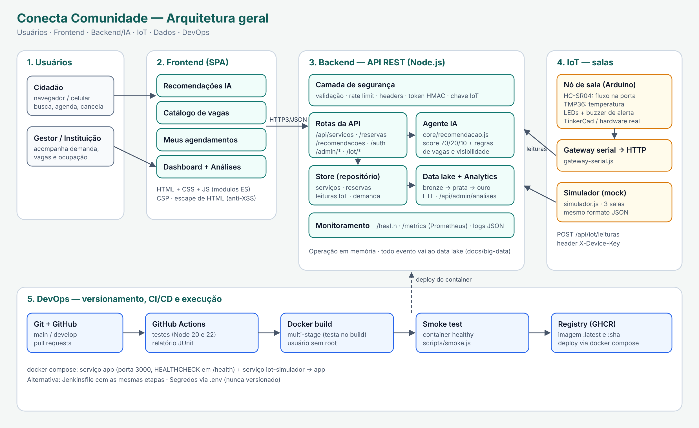

| Camada | O que faz | Conexões |
|---|---|---|
| Frontend (6 telas) | Recomendações IA, Catálogo, Meus agendamentos, Login, Dashboard e Análises | API REST (JSON) |
| API Node.js | Rotas, segurança, agente IA, reservas, monitoramento | Frontend, sensores, data lake |
| Agente IA | Recomendação explicável (regras 1 a 6) | Usa o saldo de vagas da API |
| IoT | Nó de sala Arduino (HC-SR04 + TMP36) ou simulador | `POST /api/iot/leituras` com chave de dispositivo |
| Data lake | Bronze → prata → ouro, ETL e indicadores | Recebe eventos da API e alimenta a tela Análises |
| DevOps | Git, GitHub Actions, Docker, Jenkins | Testa, processa os dados, gera a imagem e faz o smoke test a cada push |

## 3. Área 1 — IA e automação

### 01 · IA aplicada

O agente **Conecta-IA** (`src/core/recomendacao.js`) lê o pedido escrito do jeito da pessoa ("to sem trampo", "vendo artesanato") e indica até 3 serviços com score, prioridade, justificativa e próximo passo:

- **Score:** 70% objetivo (palavras-chave), 20% turno e 10% impacto social, com mínimo de 60.
- **Disponibilidade:** nunca recomenda serviço esgotado.
- **Outro turno:** quando nada cabe no horário pedido, sugere a opção mais próxima, avisando.
- **Acolhimento:** encaminha ao acolhimento social quando nada serve.

### 02 · Prompts, agentes e automação

**System prompt (resumo).** "Você é o Conecta-IA... Regras:

1. ignore serviços sem vagas;
2. score = 70% objetivo + 20% turno + 10% impacto, mínimo 60;
3. selos 'Últimas vagas' (≤ 5) e +5 para turma ociosa que começa em até 7 dias;
4. ao agendar, baixe a vaga do saldo;
5. sem opção no turno, sugira a mais próxima em outro turno e avise;
6. no máximo 3, descartando opções 20+ pontos abaixo da melhor.

Entenda o vocabulário do dia a dia. Nunca invente serviço. Responda só em JSON."

O prompt completo, com entrada, vocabulário, privacidade, formato de saída e exemplo, está em `docs/ia/prompt-do-agente.md` e no PDF `docs/ia/area1-ia-e-automacao.pdf`.

**Regras de automação da plataforma:**

| # | Gatilho | Ação automática |
|---|---|---|
| A1 | Agendamento | Confere se o CPF já tem reserva no serviço (uma vaga por pessoa), baixa a vaga e gera o protocolo |
| A2 | Cancelamento | Devolve a vaga ao saldo |
| A3 | Vagas = 0 | Serviço sai das recomendações e aparece como "Esgotado" |
| A4/A5 | Sala lotada ou acima de 30 °C | Alerta no dashboard; LED e buzzer no Arduino |
| A6 | Qualquer busca, reserva ou leitura | Evento gravado no data lake, com o nome pseudonimizado |
| A7 | ETL | Limpa, deduplica, modela e recalcula os indicadores |
| A8 | Indicadores do período | "O que decidir agora": recomendações ao gestor |
| A9 | Push no GitHub | Testes, pipeline de dados, build da imagem e smoke test |

### 03 · Demonstração (entrada → saída)

**Entrada:** `{ "situacao_atual": "Buscando renda extra / empreender", "interesse_principal": "Geração de renda", "turno_disponivel": "noite", "descricao_livre": "vendo artesanato e quero ganhar mais dinheiro" }`

**Saída (v2):** `SRV-04 · Oficina de Empreendedorismo e Microcrédito Comunitário · 97% · Alta aderência`, com cálculo "objetivo 70/70 · turno 20/20 · impacto 7/10". **A v1 não recomendava nada** para esse pedido.

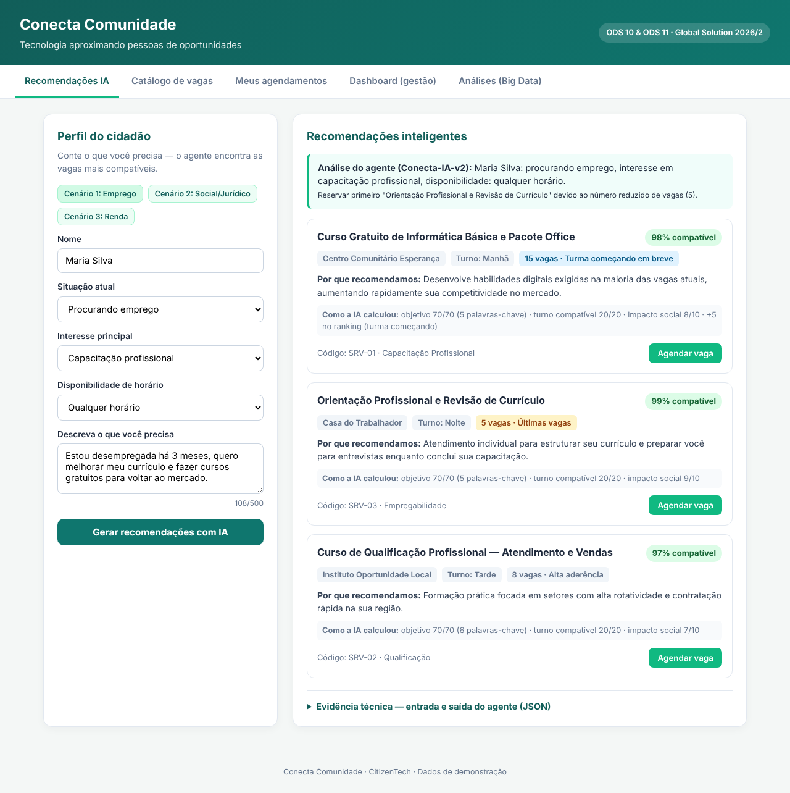

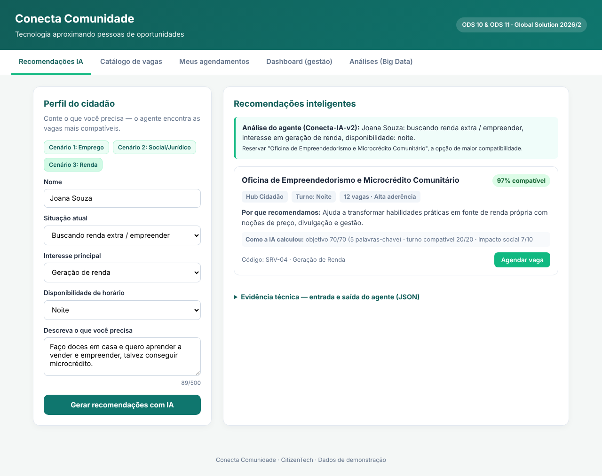

### 04 · Lógica e ganho: antes × depois

Medimos com um gabarito de perfis rotulados (o serviço que um atendente social indicaria). Os 16 perfis de **validação** nunca foram usados para ajustar a IA. Para reproduzir: `npm run ia:avaliar`.

| Métrica (validação) | Antes: mural sem IA | Agente v1 | **Agente v2** |
|---|---:|---:|---:|
| 1ª sugestão é adequada | 64,3% | 85,7% | **92,9%** |
| Sugestões que são adequadas (precisão) | 53,6% | 81,3% | **82,4%** |
| Tinha opção certa e ficou sem resposta | 0% | 14,3% | **0%** |
| Viu serviço esgotado | 37,5% | 0% | **0%** |
| Pedido fora do catálogo → acolhimento | 0% | 100% | **100%** |

**Ciclo de melhoria:** o dashboard de Big Data mostrou 65% das buscas de "geração de renda" sem resultado, mesmo com vagas sobrando. A v2 ampliou o vocabulário (47 equivalências) e criou as regras 5 e 6. Limite reconhecido: as sugestões no turno pedido caíram de 87,5% para 82,4%, porque a Regra 5 passou a oferecer outro turno a quem antes não recebia nada.

## 4. Área 2 — Big Data e visualização

### 01 · Estrutura dos dados

**Data lake em camadas (arquitetura medalhão):**

- **Bronze:** eventos brutos e imutáveis em JSON Lines, particionados por `tipo/dt=data`. São 43.635 eventos.
- **Prata:** dados validados, sem duplicados e com datas normalizadas. São 43.086 registros.
- **Ouro:** **modelo estrela** com 4 dimensões (`dim_servico`, `dim_turma`, `dim_sala`, `dim_data`) e 4 fatos (`fato_busca`, `fato_recomendacao`, `fato_reserva`, `fato_ocupacao_hora`), em CSV para Power BI e JSON para a aplicação.
- **Quarentena:** os registros recusados, cada um com o motivo.
- **Catálogo e qualidade:** `_catalogo.json` (linhagem) e `_qualidade.json`.

### 02 · Ingestão e processamento

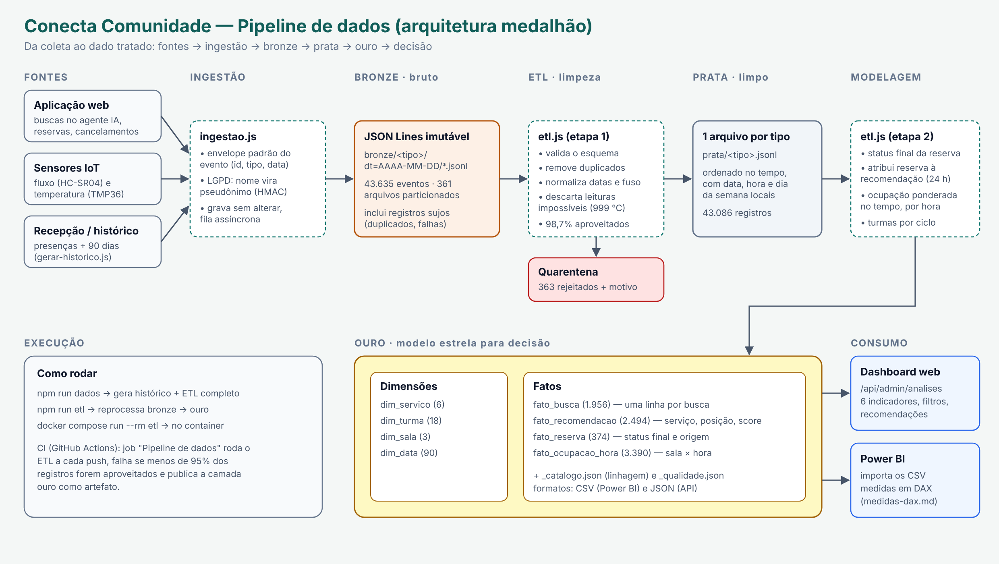

**Saída real do ETL (`npm run dados`):**

| Etapa | Resultado |
|---|---|
| Arquivos e registros lidos (bronze) | 361 arquivos · 43.635 registros |
| Duplicados removidos | 186 |
| Datas em formato antigo normalizadas | 109 |
| Rejeitados para a quarentena | 363 (JSON quebrado 88, sala inexistente 197, temperatura impossível 75, perfil inválido 3) |
| Válidos (prata) | 43.086 (98,74%) |
| Ouro | fato_busca 1.956 · fato_recomendacao 2.494 · fato_reserva 374 · fato_ocupacao_hora 3.390 |

O ETL também calcula três coisas:

- o status final de cada reserva (compareceu, faltou, cancelada ou sem vaga);
- a ligação de cada reserva à recomendação que a gerou (busca da mesma pessoa até 24 h antes);
- a ocupação real das salas a partir das passagens do sensor (média ponderada no tempo).

O CI roda esse pipeline a cada push e falha se menos de 95% dos registros forem aproveitados.

### 03 · Dashboard

A tela **Análises (Big Data)** tem:

- **6 indicadores** com variação em relação ao período anterior: utilização das vagas, conversão da recomendação, pessoas sem atendimento, comparecimento, aderência ao turno e ocupação física;
- **filtros** de período (7, 30 ou 90 dias, ou datas livres), eixo, turno e sala;
- **gráficos**: buscas e reservas por dia com média móvel, utilização por serviço, matriz eixo × turno e mapa de calor das salas;
- o painel **"O que decidir agora"**, que transforma os indicadores em decisões: ampliar o CRAS e o jurídico, abrir capacitação à noite na SALA-A (8% ocupada), climatizar a SALA-C (94 horas acima de 30 °C), reduzir faltas e divulgar a oficina de empreendedorismo.

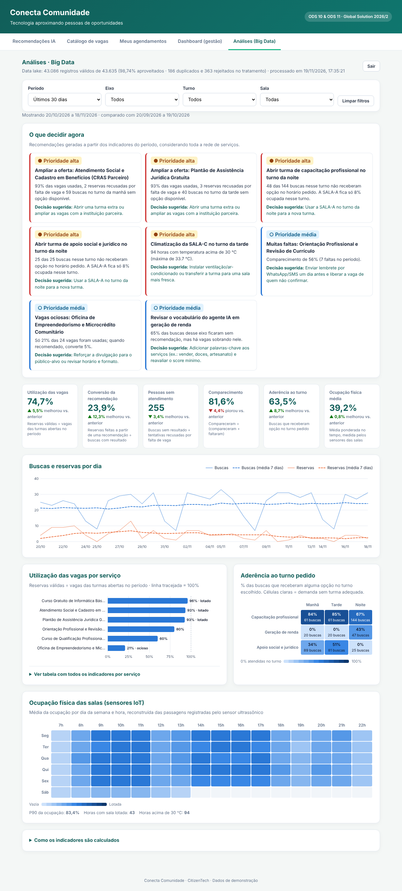

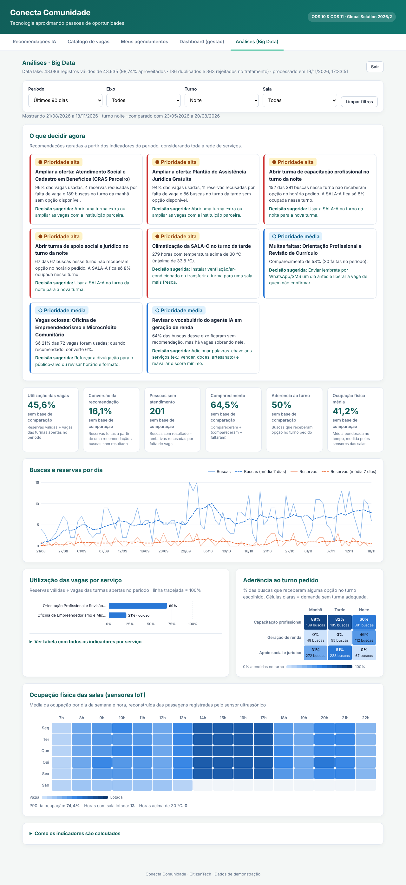

### 04 · Funções analíticas

| Medida | Função equivalente em DAX |
|---|---|
| Taxas (utilização, conversão, comparecimento) | `DIVIDE(numerador, denominador)` |
| Contagens filtradas | `COUNTROWS(FILTER(...))`, `CALCULATE` |
| Comparação com o período anterior | `DATEADD(dim_data[data], -N, DAY)` + `DIVIDE([Atual]-[Anterior], [Anterior])` |
| Média móvel de 7 dias | `AVERAGEX(DATESINPERIOD(..., -7, DAY), [Medida])` |
| P90 da ocupação | `PERCENTILEX.INC(..., 0.9)` |
| Ranking de serviços | `RANKX(ALL(dim_servico), [Taxa de Utilização], , DESC, DENSE)` |

O código das medidas está em `src/dados/medidas.js`. As fórmulas DAX completas, prontas para o Power BI, estão em `docs/big-data/medidas-dax.md`.

## 5. Área 3 — MVP, IoT e experiência digital

### 01 · Protótipo: 6 telas funcionais

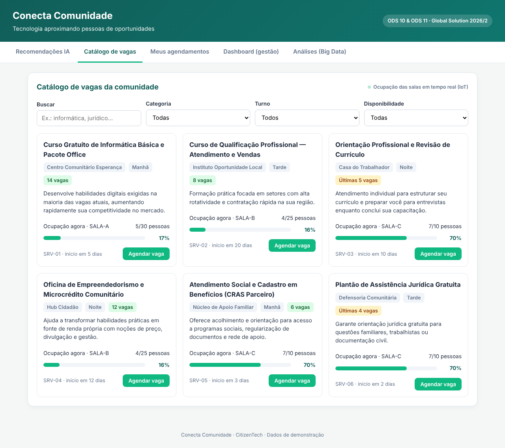

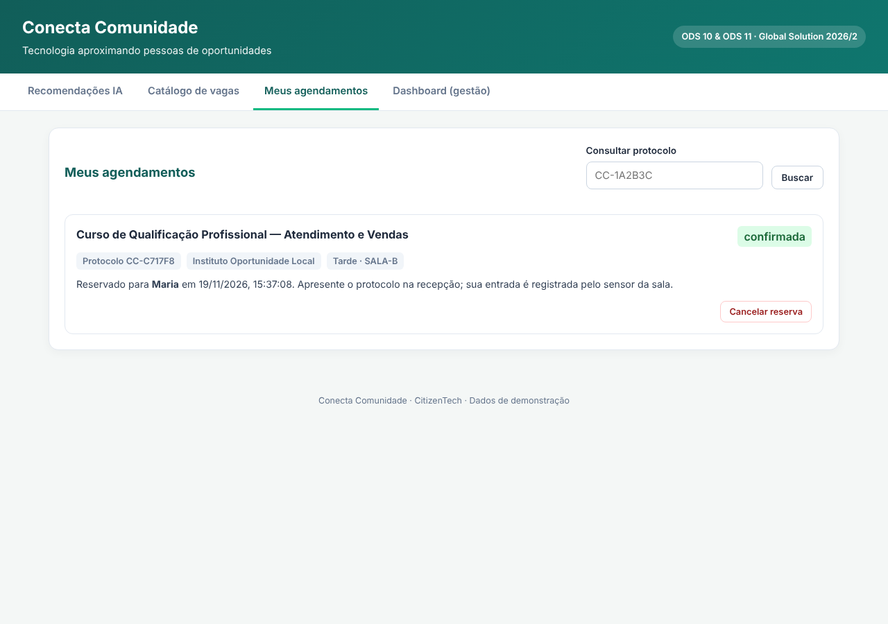

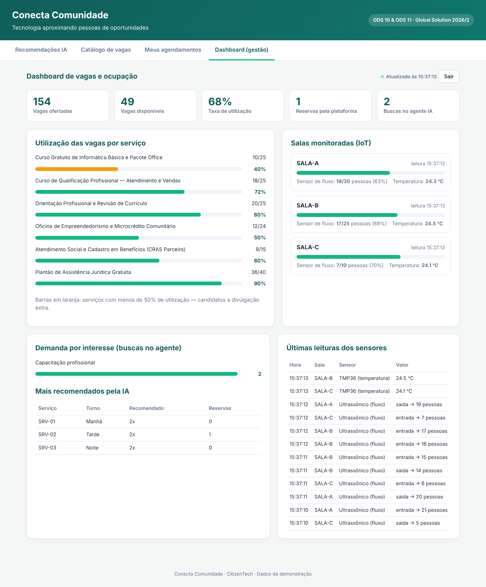

As outras telas (Recomendações, Login e Análises) aparecem nas seções 3 e 4 e nos prints da Área 4.

### 02 · IoT: 2 sensores

| Sensor | Função | Implementação |
|---|---|---|
| **HC-SR04** (ultrassônico) na porta | Conta entradas e saídas, para saber a ocupação da sala | `iot/arduino/no_sala.ino` (TinkerCad) e simulador `src/iot/simulador.js` |
| **TMP36** (temperatura) | Conforto e segurança da sala | Idem |
| Atuadores | LED verde ou vermelho (lotação) e buzzer (mais de 30 °C) | Arduino |

O simulador e o Arduino enviam o mesmo JSON. Um gateway serial → HTTP (`src/iot/gateway-serial.js`) liga o hardware real à API, que exige a chave de dispositivo.

Log real do simulador:
`{"sala":"SALA-C","sensor":"fluxo","evento":"entrada"} -> HTTP 201 | ocupação 8/10 | ALERTA: Ocupação acima de 80%`

### 03 · Fluxo funcional (do início ao fim)

1. Maria descreve sua situação na tela Recomendações IA.
2. O agente indica 3 serviços com justificativa e o cálculo.
3. Ela agenda com nome e CPF e recebe o protocolo. A vaga sai do saldo na hora, e um segundo agendamento com o mesmo CPF é bloqueado.
4. Ela acompanha a reserva em Meus agendamentos.
5. No dia, o sensor da sala registra a entrada.
6. O gestor vê a ocupação no Dashboard.
7. Os eventos vão ao data lake. Depois do ETL, a tela Análises mostra os indicadores e as decisões sugeridas.

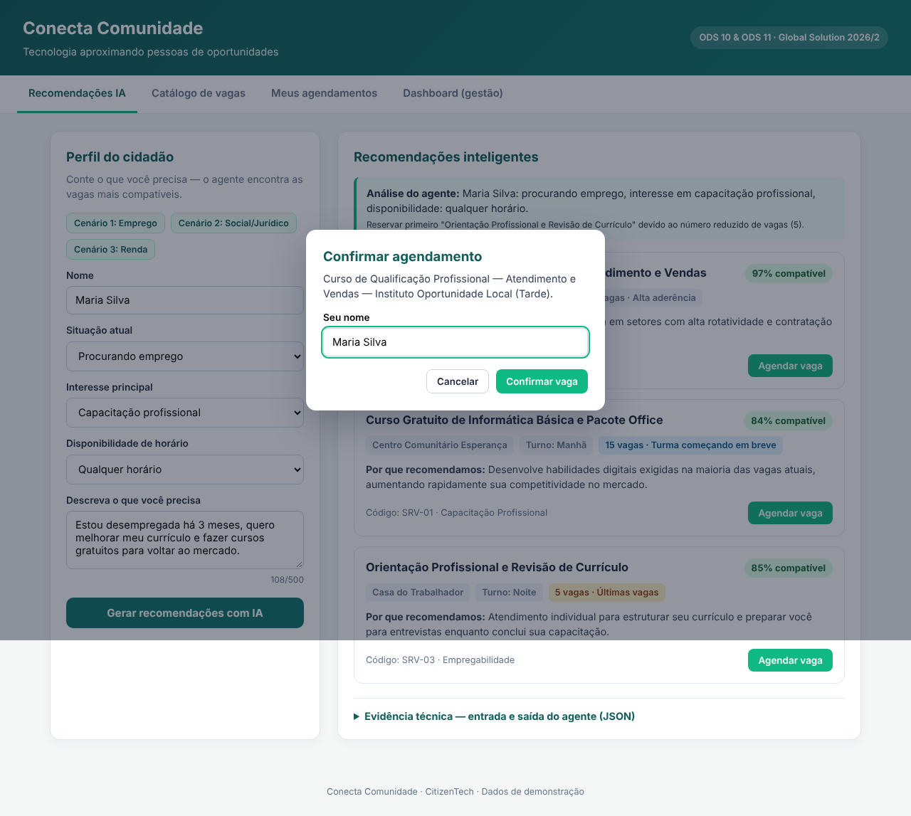

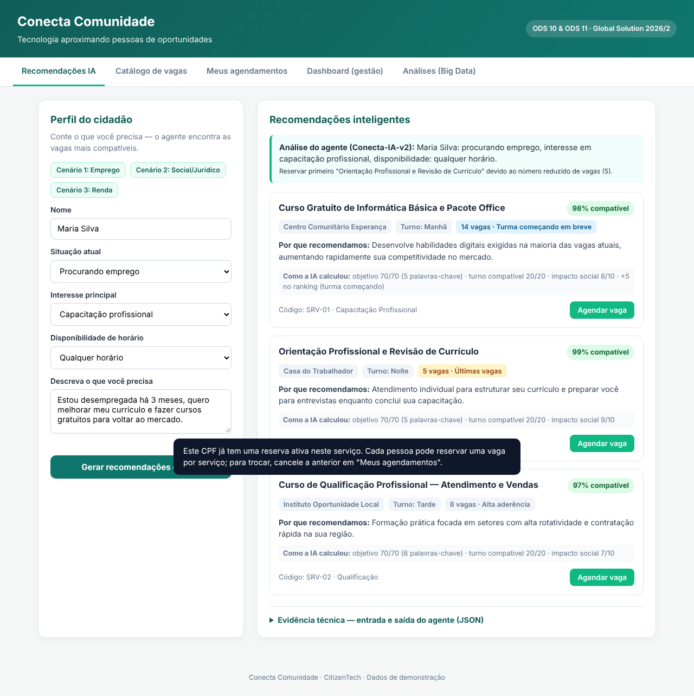

### 04 · Arquitetura

O diagrama geral está na seção 2. O pipeline de dados está detalhado na seção 4.

## 6. Área 4 — DevOps, segurança e qualidade

### 01 · Organização

O código está separado em módulos: `src/core` (IA), `src/server` (API e segurança), `src/dados` (Big Data), `src/iot`, `public` (telas), `tests`, `docs`. O projeto é versionado com Git, com commits por etapa, como estes:

`feat(ia): isola o núcleo do agente` · `feat(api): API REST com reservas e segurança` · `feat(web): telas` · `feat(iot): simulador e sketch Arduino` · `test: casos unitários e de integração` · `ci: Docker, compose, GitHub Actions` · `feat(dados): data lake bronze/prata/ouro` · `feat(ia): agente v2` · `feat: uma reserva por pessoa (CPF)`

### 02 · DevOps funcionando

A pipeline do **GitHub Actions** roda a cada push:

1. testes no Node 22 e 24;
2. pipeline de dados com checagem de qualidade;
3. build da imagem Docker, container *healthy* e smoke test;
4. publicação da imagem no GitHub Container Registry.

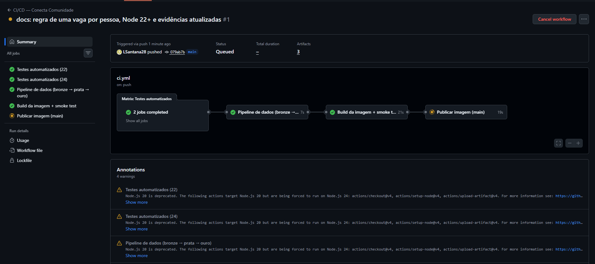

Detalhes da parte Docker e de monitoramento:

- **Docker:** build em dois estágios (os testes rodam durante o build), usuário sem privilégios e `HEALTHCHECK` em `/health`.
- **docker compose:** sobe o app, o simulador IoT e o ETL, com um volume para o data lake.
- **Monitoramento:** `/health`, `/metrics` no formato Prometheus e logs em JSON.
- **Jenkinsfile** como alternativa ao GitHub Actions.

### 03 · Segurança (11 práticas)

| Prática | Onde |
|---|---|
| Validação de entrada (listas fechadas, tamanho, formato) e limite de 10 KB por requisição | `seguranca.js` |
| Proteção contra XSS (escape de todo dado + Content-Security-Policy) | frontend e cabeçalhos |
| Login do gestor: senha com hash scrypt e token HMAC com validade de 1 h | `/api/auth/login` |
| Chave de dispositivo para os sensores IoT | `/api/iot/leituras` |
| Limite de requisições e de tentativas de login (anti força bruta) | rate limiter |
| Cabeçalhos de segurança e bloqueio de acesso a arquivos fora da pasta pública | servidor |
| Uma vaga por pessoa: CPF validado e guardado só como chave HMAC | reservas |
| LGPD: só o primeiro nome é guardado; nomes mascarados; pseudônimo no data lake | API e ingestão |
| Segredos obrigatórios em produção; container sem root | configuração e Docker |

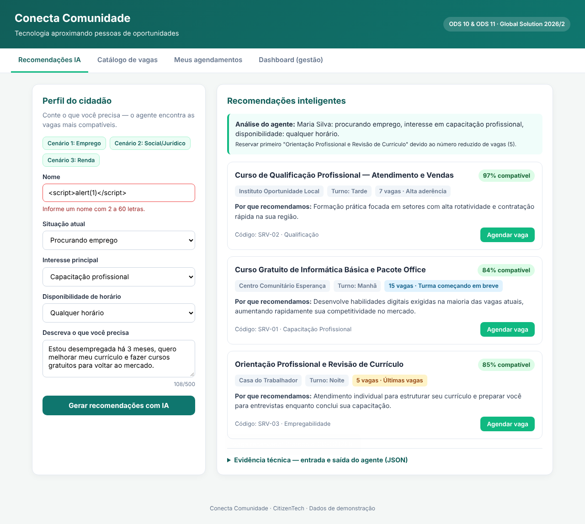

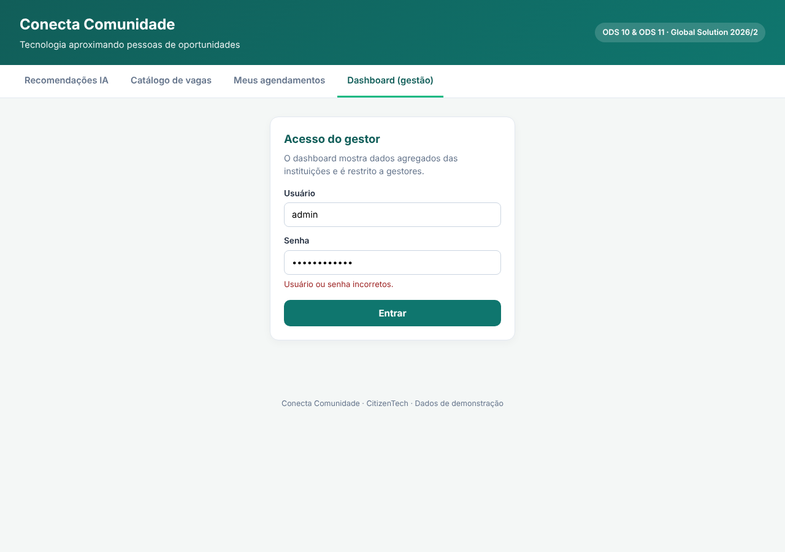

### 04 · Testes: plano e execução

O plano completo está em `docs/plano-de-testes.md`: **33 casos automatizados + 11 de ponta a ponta no navegador**, cobrindo IA, API, segurança, IoT, data lake e monitoramento.

| Execução | Resultado |
|---|---|
| `npm test` (unitários e integração) | **33 testes · 33 aprovados · 0 falhas** |
| Roteiro no navegador (Playwright, 6 telas) | 11 cenários, sem erros no console |
| Smoke test (`npm run smoke`) | 7/7 checagens aprovadas |
| CI (GitHub Actions) | Todos os jobs verdes (print acima) |

Exemplos de casos de teste:

- **CT06:** fluxo completo (recomendar, reservar, cancelar e devolver a vaga).
- **CT09:** o dashboard exige login.
- **CT11:** alertas de lotação e temperatura vindos dos sensores.
- **CT18:** o ETL remove duplicados e manda os registros inválidos para a quarentena.
- **CT25:** o ganho da IA (v2 > v1 > sem IA).
- **CT26:** uma vaga por CPF em cada serviço.

## 7. Uso de IA generativa

| Ferramenta | Para quê |
|---|---|
| Claude (Anthropic) | Apoio no desenvolvimento a partir do protótipo inicial da equipe (agente de recomendação em HTML/JS): organização do código em módulos, API, telas, simulador IoT, pipeline de dados, testes, Docker e CI, e redação da documentação. Também usado para explicar erros e revisar textos |

A equipe revisou o código e a documentação, executou os testes e é responsável pelo conteúdo entregue.
