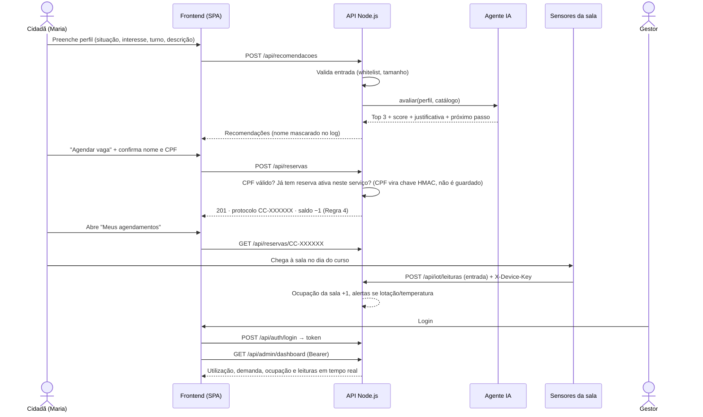

# Fluxo funcional completo (do início ao fim)

Persona: **Maria Silva**, desempregada há 3 meses, quer cursos gratuitos para voltar ao mercado.

## Passo a passo (para a demonstração)

1. `npm start` e, em outro terminal, `npm run iot` (ou `docker compose up --build`).
2. Abrir `http://localhost:3000` → tela **Recomendações IA** → **Cenário 1: Emprego**.
3. O agente mostra 3 serviços: Qualificação (97%), Informática (84%, "turma começando em breve") e Orientação (85%, "últimas vagas"), e sugere reservar primeiro a Orientação.
4. Clicar **Agendar vaga** → confirmar o nome e informar o CPF → aparece o protocolo. O saldo cai na hora; ao gerar de novo, o card mostra 1 vaga a menos. Tentar agendar de novo o mesmo serviço com o mesmo CPF é bloqueado (uma vaga por pessoa).
5. Tela **Meus agendamentos**: a reserva aparece como *confirmada*, com opção de cancelar (a vaga volta ao saldo).
6. Tela **Catálogo**: todas as vagas, filtros por categoria/turno e a barra **Ocupação agora** alimentada pelos sensores.
7. Tela **Dashboard (gestão)**: login `admin` / `conecta2026` (demo). KPIs, utilização por serviço (laranja = menos de 50%, precisa de divulgação), demanda por interesse, salas IoT com alertas e últimas leituras — atualiza a cada 3 s.

8. Aba **Análises (Big Data)**: indicadores do data lake com filtros de período, eixo, turno e sala, comparados ao período anterior, mais o painel **O que decidir agora**. Exemplos: ampliar o plantão jurídico, abrir capacitação noturna na SALA-A (ociosa à noite), climatizar a SALA-C.
9. Tudo o que foi feito nos passos 2 a 6 já foi gravado na camada bronze. Rode `npm run etl` e recarregue a tela de análises para ver os dados novos processados.

Screenshots de cada passo: `docs/evidencias/01` a `10`.
